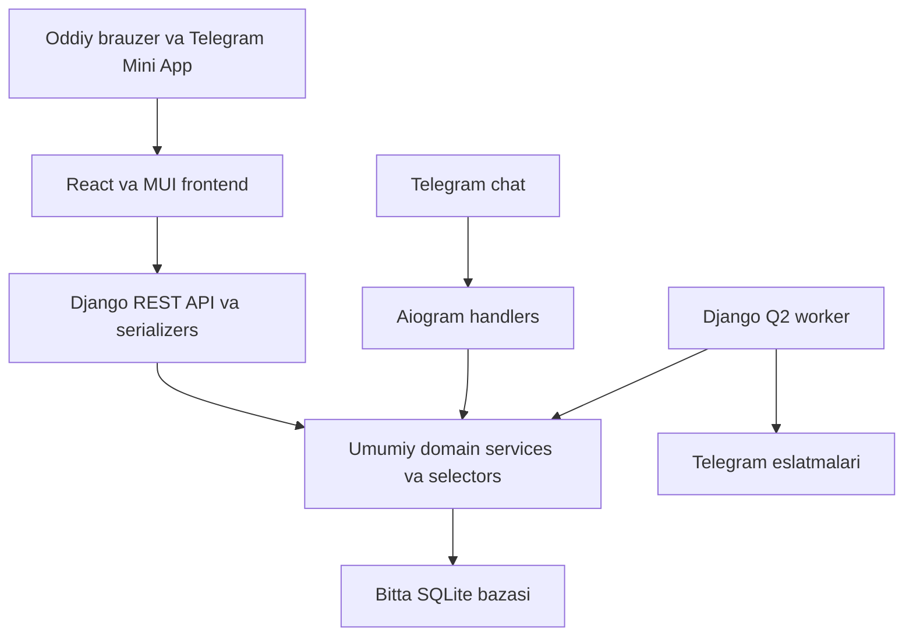

# Deenly shaxsiy veb platformasi

2026 yil 11 oktabr. Birinchi versiya faqat bot egasi uchun.

Deenly uchun tanlangan stack — Django backend va React + MUI frontend. Telefon va kompyuterda ishlaydigan shaxsiy kabinet, keyin aynan shu interfeysni ochadigan Telegram Mini App rejalashtiriladi. Bot va sayt bir xil foydalanuvchi, biznes servislar va SQLite bazasini ishlatadi. Saytda tugatilgan takrorlash yoki qazo botda ham ko‘rinadi; botda boshlangan o‘rganish saytda davom etadi.

Ushbu hujjat dastlabki texnik va mahsulot researchini saqlaydi. Keyingi bosqichda
`frontend/` va `backend/`ga ajratilgan mahalliy veb kabinet, REST API va Telegram
autentifikatsiyasi implementatsiya qilindi. Amaldagi holat [README](../README.md)
va [API kontrakti](API_CONTRACT.md)da. Quyidagi audit dastlabki holatga tegishli;
production deploy rejalari bajarilgan ish sifatida talqin qilinmasin.

## Hozirgi loyiha

| Qism | Mavjud imkoniyat | Veb uchun zarur ish |
| --- | --- | --- |
| Django | 5.2 oilasi, auth, sessions, CSRF, Admin | DRF API, React frontend va Telegram orqali kirish |
| Foydalanuvchi | Yagona `TelegramUser`, til, vaqt zonasi, owner rejimi | Django auth akkauntini shu mavjud profilga bog‘lash |
| Ismlar | Ketma ket tanishtirish, tasdiqlash, 4 turdagi test, interval takrorlash | Kartochkalar, tanishtirilgan ismlar ro‘yxati, test interfeysi |
| Arab tili | 38 dars, 95 kartochka, 3 kategoriya, 5 turdagi test | Darslar yo‘li, o‘qish oynasi va takrorlash |
| Kutubxona | 11 oyat yoki parcha, 5 to‘liq sura, 13 duo, 3 tildagi matnlar | Qidiruv, filtrlar, o‘qish sozlamalari va pagination |
| Qazo | Qo‘lda qo‘shilgan va tarixiy namoz navbati, ro‘za miqdori | Sana va namoz formasi, navbat, tasdiqlash va tarix |
| Taqvim va hisobot | Muhim sanalar, hududiy tuzatishlar, haftalik hisobot JSONi | Taqvim va statistikani vebda ko‘rsatish |
| Xabarlar | Django Q2, Telegramga yuborish, tasodifiy yarim soatlik vaqtlar | To‘liq sozlamalar formasi va saytga o‘tish havolalari |

Asosiy dalillar: `config/urls.py` faqat `/admin/` va `/health/`ni ochadi; `apps/users/models.py` shaxsiy identifikatorni saqlaydi; `apps/learning/services.py`, `apps/arabic_learning/services.py`, `apps/worship/services.py` va `apps/notifications/services.py` biznes qoidalarni ajratib turadi. Kontent sonlari seed kodi va `tests/test_content.py`, `tests/test_arabic_learning.py` bilan tekshirildi; ular production bazasining joriy inventarizatsiyasi emas.

Mahalliy `manage.py check` muammosiz yakunlandi va mavjud 64 test o‘tdi. `193.164.17.34` serverida bot, worker va web konteynerlari ishlayotgani, web healthy ekani hamda lokal `/health/` javobi tekshirildi. Bu autentifikatsiya yoki yangi sayt ishlayotganini anglatmaydi: hozirgi health javobi DBni tekshirmaydi.

## Mahsulot yo‘nalishi

Platforma markazida bugungi kichik amallar turadi: navbatdagi ism, muddati kelgan takrorlash, davom ettiriladigan arab tili darsi va joriy qazo. Bosh sahifa bu amallarga to‘g‘ridan to‘g‘ri olib boradi.

[Quran.com](https://quran.com/about-us) o‘qish, tarjima, audio, qidiruv, belgilash va shaxsiy qaydlarni birlashtiradi. Deenly uchun shu o‘qish qulayligini olish mumkin. [Quranly](https://www.quranly.app/) kunlik o‘qish maqsadi va progressga urg‘u beradi; Deenlyda kichik kunlik vazifalar va haftalik hisobot shu tamoyildan foydalanishi mumkin. Bular mahsulotga oid takliflar, raqobatchilarning dizaynini ko‘chirish talabi emas.

## Birinchi versiyaning sahifalari

| Sahifa | Haqiqatan ishlashi kerak bo‘lgan harakatlar |
| --- | --- |
| Bugun | Davom ettirish, muddati kelgan takrorlashlar soni, joriy qazo, yaqin sana va haftalik natija |
| Allohning ismlari | Navbatdagi ismni o‘qish, alohida tasdiqlash, tanishtirilgan ismlar, 4 xil test va yana mashq qilish |
| Arab tili | Alifbo, Qur’on so‘zlari va iboralari, grammatika; darsni davom ettirish, tugatish va test |
| Qur’on | Oyatlar va suralar alohida; sarlavha va sura raqami bo‘yicha qidiruv, 10 tadan pagination, arabcha matn, tarjima va transkripsiya |
| Duolar | 10 tadan pagination, qidiruv, o‘qish va saralanganlarga qo‘shish |
| Saralanganlar | Botdagi mavjud oyat va duolar, qo‘shish va olib tashlash |
| Qazo | Bir martalik tarixiy sozlash, sanali namoz qo‘shish, eng oxirgi qo‘lda qo‘shilgan namoz, keyin tarixiy navbat, bajarilganlar tarixi; ro‘za qarzini qo‘shish va bir kunni bajarish |
| Taqvim | Gregorian va hijriy sanalar, yaqin voqealar, hisoblangan yoki hudud bo‘yicha tasdiqlangan sana holati |
| Natijalar | Ismlar, arab tili, test aniqligi, qazo bajarilganlari va mavjud haftalik hisobotlar |
| Sozlamalar | UZ/RU/EN, vaqt zonasi, tasodifiy xabarlar soni va vaqt oralig‘i, haftalik hisobot; bot bilan bir xil qiymatlar |

Ism kartochkasini ochish progressni o‘zgartirmaydi. Test variantlari faqat tanishtirilgan ismlardan olinadi; to‘rtta ism bo‘lmaganda test o‘rniga o‘rganishni davom ettirish ko‘rsatiladi. “Yana mashq” mavjud `extra_practice` qoidasi bilan ishlaydi: javob statistikasi yoziladi, rejalashtirilgan takrorlash vaqti surilmaydi.

Arab tili uchun tavsiya — “davom ettirish” tugmasi ketma ket keyingi darsga olib boradi, qolgan chop etilgan darslarni esa ko‘rib chiqish mumkin. Qazo navbati oldingi kelishuvni saqlaydi: qo‘lda qo‘shilgan eng yangi sana va shu sanadagi kechroq namoz avval; ular tugasa tarixiy kursor orqaga yuradi. Vitr hisoblanmaydi.

Telefonda pastki navigatsiya: Bugun, O‘rganish, Kutubxona, Qazo, Profil. Kompyuterda shu bo‘limlar yon panelda bo‘ladi. UI matnlari UZ/RU/EN; arabcha parchalar `lang="ar"`, `dir="rtl"`, to‘g‘ri harakatlar va o‘qiladigan satr oralig‘i bilan chiqadi. Yorug‘ va qorong‘i mavzu, matn kattaligi, klaviatura bilan boshqarish hamda aniq yuklanish, xato va bo‘sh holatlar kerak.

## Texnologiya tanlovi

| Qism | Vazifasi |
| --- | --- |
| Django va Django REST framework | `/api/v1/` JSON API, autentifikatsiya, validatsiya va umumiy domain servislar |
| React va TypeScript | Sahifalar, o‘rganish oqimlari, lokal UI holati va Telegram Mini App adapteri |
| Vite | Frontend development va production uchun statik build |
| MUI | Responsive layout, komponentlar, formalar, light/dark tema va yagona dizayn tokenlari |
| React Router | Kabinet sahifalarining navigatsiyasi va brauzer tarixini boshqarish |
| TanStack Query | API ma’lumotlarining keshi, mutationdan keyingi yangilanish va loading/error holatlari |
| SQLite va Django Q2 | Mavjud progress bazasi, fon vazifalari va Telegram xabarlari |

Frontend va backend bitta HTTPS originda bo‘ladi: `/` React buildni, `/api/` va `/auth/` Djangoni, `/admin/` mavjud Adminni ochadi. Frontend SPA fallbacki API, auth, admin, static va health yo‘llarini tutib qolmaydi. Vite builddan keyin alohida Node runtime kerak emas. [Vite backend integratsiyasi](https://vite.dev/guide/backend-integration)

React Django HttpOnly sessiya cookie orqali APIga murojaat qiladi. Yozish so‘rovlariga CSRF token uzatiladi; owner permission API tomonidan tekshiriladi. DRF SessionAuthentication Django sessiyasi bilan ishlaydi, lekin login endpointining CSRF himoyasi alohida ta’minlanadi. [DRF session authentication](https://www.django-rest-framework.org/api-guide/authentication/#sessionauthentication)

Auth tokenlari va shaxsiy API keshi `localStorage`ga yozilmaydi. Mutationdan keyin tegishli querylar yangilanadi; logoutda shaxsiy query keshi tozalanadi. Eskirgan qazo sahifasi yoki botda javob berib bo‘lingan quizning natijasi server javobiga qarab yangilanadi. Shaxsiy javoblar umumiy proxy cachega tushmaydi.

MUI custom theme bilan Deenlyga moslashtiriladi. Vizual yo‘nalish va sayt namunalari [dizayn researchida](DESIGN_RESEARCH.md) keltirilgan. Versiyalar implementatsiya paytida tekshiriladi va lock fayllarda mahkamlanadi.

## Umumiy arxitektura



API view sessiyadan foydalanuvchini oladi, serializer payloadni tekshiradi va domain servisni chaqiradi. Servis qoidani bajaradi; React API natijasini ko‘rsatadi. Bot handleri ham aynan shu servisdan foydalanadi. Sinxronizatsiya alohida ko‘chirish jarayoni emas: barcha interfeyslar bir DBdagi bir yozuvni o‘qiydi. Ochiq sahifa mutationdan keyin va qayta fokus olganda yangilanadi; birinchi versiyada WebSocket zarur emas.

Taklif etilgan yangi kod joylashuvi:

```text
apps/api/
    urls.py
    views/          dashboard, names, arabic, library, worship, calendar, reports
    serializers/    o‘qish javoblari va amal payloadlari
    permissions.py  owner va faol profil tekshiruvi
    selectors/      faqat o‘qish uchun dashboard va hisobot ma’lumotlari
apps/users/auth/
    backend.py
    telegram_oidc.py
    telegram_miniapp.py
frontend/src/
    app/            router, providers va umumiy layout
    api/            HTTP client va API turlari
    features/       dashboard, names, arabic, library, worship, calendar, reports
    components/     qayta ishlatiladigan UI komponentlari
    theme/          MUI tokenlari va component overrides
    locales/        uz, ru va en interfeys tarjimalari
```

Mavjud ilovalardagi model va servislar o‘z joyida qoladi. Bot handlerida qolgan kutubxona paginationi kabi o‘qish qoidalari umumiy selectorlarga ajratiladi. Haftalik hisobotning hisoblash qismi va Telegram matnini render qilish qismi ajratiladi. API structured ma’lumot qaytaradi; Telegram uchun render qilingan HTMLni Reactga raw HTML sifatida uzatish kerak emas. Interfeys tarjimalari frontendda, kontent tarjimalari esa mavjud DBda saqlanadi.

## Telegram orqali kirish

Oddiy brauzer uchun Telegramning hozirgi OIDC Authorization Code va PKCE oqimi mos. BotFatherda origin, callback URL, Client ID va Secret sozlanadi. `openid profile` bilan tekshirilgan `id` mavjud `TelegramUser.telegram_id`ga bog‘lanadi; OIDC `sub` shu raqam deb olinmaydi. `state`, `nonce`, token imzosi, issuer, audience va amal qilish vaqti tekshiriladi. [Telegram Login](https://core.telegram.org/bots/telegram-login)

OIDC mijoz qismi uchun [Authlib Django integratsiyasi](https://docs.authlib.org/en/v1.7.0/oauth2/client/web/django.html) kabi mavjud kutubxona ishlatilishi mumkin. Telegramga mos konfiguratsiya va identity mapping integratsiya testida tekshiriladi.

Mini App botning menu yoki inline Web App tugmasidan shu saytni ochadi. Backend raw `initData` imzosini va `auth_date`ni tekshiradi; `initDataUnsafe` autentifikatsiya dalili emas. Tekshirilgan `user.id` ham shu profilga olib boradi. Tema, safe area va Telegram BackButton oddiy sayt UI ustiga kichik adapter sifatida qo‘shiladi. [Telegram Mini Apps](https://core.telegram.org/bots/webapps)

Mavjud `TelegramUser`ga `AUTH_USER_MODEL` bilan nullable OneToOne bog‘lanish qo‘shish tavsiya etiladi. Tasdiqlangan Telegram egasi kirganda Django auth useri kerak bo‘lsa yaratiladi va mavjud profilga bog‘lanadi; paroli ishlatilmaydi. Progress FKlarini ko‘chirish shart emas. Keyingi so‘rovlar Django server sessiyasidan foydalanadi. [Django login va sessions](https://docs.djangoproject.com/en/5.2/topics/auth/default/#how-to-log-a-user-in)

Bu additive migratsiya bo‘ladi; mavjud Django user modeli almashtirilmaydi. Telegram OIDC uchun identity tekshirilgan ID-token claimlaridan olinadi, alohida UserInfo endpoint mavjud deb taxmin qilinmaydi. React backenddan `/api/v1/me/` orqali sayt sessiyasi va profil holatini oladi.

Telegram Web ichida Mini App iframe orqali ochilsa, hozirgi Django `X-Frame-Options: DENY` uni bloklaydi. Mini App yo‘llari uchun alohida frame policy va tekshirilgan Telegram parent originlariga cheklangan CSP `frame-ancestors` kerak. Oddiy sayt va Admin o‘z frame himoyasini saqlaydi. [Django frame himoyasi](https://docs.djangoproject.com/en/5.2/ref/clickjacking/), [CSP frame ancestors](https://developer.mozilla.org/en-US/docs/Web/HTTP/Reference/Headers/Content-Security-Policy/frame-ancestors)

Cross-site iframe sessiyasida cookie uchun `SameSite=None; Secure` kerak bo‘lishi mumkin, lekin bu brauzerning third-party cookie blokini bekor qilmaydi. Native Telegram, Telegram Web va oddiy brauzerda login alohida sinaladi; embedded cookie ishlamasa tashqi brauzerda OIDC orqali kirish taklif etiladi. Telegram Web ichida uzluksiz ishlash alohida talabga aylansa, qisqa muddatli, xotirada saqlanadigan credential bilan cookiega bog‘liq bo‘lmagan adapter kerak bo‘lishi mumkin. [Django SameSite](https://docs.djangoproject.com/en/5.2/ref/settings/#session-cookie-samesite), [Mozilla third party cookies](https://developer.mozilla.org/en-US/docs/Web/Privacy/Guides/Third-party_cookies)

Owner ID tekshiruvi ikkala kirish yo‘lida bir xil bo‘ladi; faol bo‘lmagan profil rad etiladi. Shaxsiy vebda “birinchi kirgan odam owner” mexanizmi qo‘llanmaydi. Login botga yangi xabar yuborishga avtomatik rozilik bo‘lmaydi; mavjud foydalanuvchining xabar sozlamalari saqlanadi. Login tokenlari brauzer `localStorage`iga yoki loglarga yozilmaydi.

## SQLite va ikki interfeysdagi amallar

SQLite shaxsiy foydalanish uchun saqlanadi. Loyihada WAL, 20 soniyalik busy timeout va bitta Q worker allaqachon bor. Ammo SQLite’da `select_for_update()` ta’sir qilmaydi; shuning uchun bot va saytning parallel javoblari hozirgi sequential testlardan tashqari tekshirilishi zarur. Qisqa yozish tranzaksiyalari uchun `transaction_mode="IMMEDIATE"`ni sinab ko‘rish tavsiya etiladi; butun HTTP so‘rovini tranzaksiyaga o‘rash kerak emas. [Django SQLite xulqi](https://docs.djangoproject.com/en/5.2/ref/databases/#transactions-behavior)

Veb kiritilishidan oldin umumiy servislar quyidagilarni kafolatlashi kerak:

- Bitta test UUIDsiga ikki parallel javob bitta attempt va bitta progress yangilanishini beradi.
- Qazo tasdiqlash sahifada ko‘rsatilgan `expected_key`ni yuboradi; eskirgan sahifa navbatdagi boshqa namozni bajarilgan qilmaydi.
- Ro‘za bajarish va miqdor qo‘shish harakatlarida noyob amal kaliti bo‘ladi; so‘rovni qayta yuborish qarzni qayta kamaytirmaydi yoki ko‘paytirmaydi.
- Saralanganlarga qo‘shish va olib tashlash alohida idempotent amallar bo‘ladi; qayta yuborilgan toggle teskari natija bermaydi.
- Sozlamalar formasi qiymatlarni bir marta saqlaydi; commitdan keyin xabar jadvali qayta tuziladi.

Bu qoidalar faqat web viewda emas, bot ham chaqiradigan domain servisda bo‘lishi kerak. Yozish tranzaksiyasi ichida tashqi HTTP yoki Telegram API chaqirig‘i bo‘lmaydi. Parallel testlar real faylli SQLite va alohida DB ulanishlarida bajariladi.

## Kontent va to‘ldirilishi kerak bo‘lgan qoidalar

Hozir ismlar dataseti 100 ta yozuv: boshida “Allah”, undan keyin mavjud 99 talik ro‘yxat. “99 ismlar” sahifasining tartib va progress denominatorini implementatsiyadan oldin aniqlash zarur. Taklif: “Allah”ni kirish kartochkasi sifatida alohida ko‘rsatish, mavjud model IDlari va o‘rganilgan progressni saqlash. Raqamli testdagi eski tartib o‘zgarsa, UI va test matnlari birga moslashtiriladi; bu diniy ro‘yxatni avtomatik qayta tuzish qarori emas.

Qur’on bo‘limi dastlab mavjud tanlangan oyat va suralar kutubxonasi bo‘ladi. To‘liq Qur’on readeri uchun [Quran Foundation Content API](https://api-docs.quran.com/docs/quickstart/) matn, tarjima va qiroat olishga mos nomzod. Hozirgi hujjatga ko‘ra credentials backendda turadi; yangi app prelive muhitidan boshlaydi, unda faqat 1 va 2 suralar bor. To‘liq dataset uchun production ruxsati kerak. Mavjud materiallarni ko‘rsatish tashqi API mavjudligiga bog‘lanmaydi.

Muqobil arabcha matn manbasi [Tanzil](https://tanzil.net/docs/text_license). Uning shartlari matnni o‘zgartirmaslik, manbani ko‘rsatish va link berishni talab qiladi. Uni import qilsak, attribution kutubxonaning alohida ma’lumot sahifasida va tarqatiladigan fayllarda saqlanadi. Tarjima va audio uchun huquqlar alohida tekshiriladi.

Arab tili modelida `audio_url` bor, lekin seed audioni to‘ldirmaydi; ishlaydigan audio uchun tekshirilgan fayllar alohida kerak. Seed manbalari `is_verified=False` bilan yaratiladi, shuning uchun UI ularni tasdiqlangan material deb ko‘rsatmaydi. Qur’on arabcha matniga brauzer auto translationi qo‘llanmasligi uchun `translate="no"` ishlatiladi. Transkripsiyalar mavjud UZ/RU/EN yozuvlardan olinadi.

Shaxsiy matnli duo yaratish, qaydlar, o‘qish maqsadi va audio keyingi qo‘shimchalar sifatida foydali. Mavjud saralanganlar esa birinchi versiyaning to‘liq funksiyasi bo‘ladi. Qazo tarixining quyi chegarasi va xato kiritilgan amalni tuzatish workflowi hozir mavjud emas; tarixiy qarzning umumiy foizi o‘ylab topilmaydi, bajarilgan son va joriy kursor ko‘rsatiladi.

Sozlamalar uchun to‘liq payload qabul qiladigan servis kerak. `quiet_start/end` maydonlari hozir xabar rejasida ishlatilmaydi; ularni UIga chiqarsak, avval amalda tatbiq qilamiz. Haftalik kun/vaqt va vaqt zonasi ham alohida validatsiya va replanning talab qiladi. Taqvim hududi hozir default `global`; hudud tanlash qo‘shilsa profil va taqvim servisi birga o‘zgartiriladi.

## Production yo‘li

Hozirgi Compose `config.settings.docker`ni ishlatadi; bu fayl `DEBUG=False`dan boshqa production himoyalarini yoqmaydi. Web porti faqat `127.0.0.1:8000`da. Ommaviy HTTPS entrypoint qo‘shishda ishonchli reverse proxy, aniq allowed hosts, secure session va CSRF cookie, trusted origins hamda proxy SSL header sozlanadi. `check --deploy` aynan ishlatiladigan production settings bilan bajariladi. [Django deployment checklist](https://docs.djangoproject.com/en/5.2/howto/deployment/checklist/)

Serverdagi mavjud reverse proxy avval inventarizatsiya qilinadi va imkon bo‘lsa undan foydalaniladi. Alohida proxy kerak bo‘lsa [Caddy](https://caddyserver.com/docs/automatic-https) domen uchun sertifikat olish va yangilashni avtomatlashtiradi. Oddiy sozlash uchun DNS serverga yo‘nalishi, 80/443 ochiq bo‘lishi va TLS ma’lumotlari persistent saqlanishi kerak. Domen hali tanlanmagan; namuna domenni haqiqiy domen sifatida ishlatmaymiz.

React/MUI frontend Vite bilan Docker build stage ichida yig‘iladi. Hashlangan JS/CSS va shriftlar reverse proxy tomonidan tarqatiladi; API Gunicornga yo‘naltiriladi. `VITE_*` qiymatlar brauzer buildiga kirishi mumkin, shuning uchun bot tokeni va OIDC secret backend konfiguratsiyasida qoladi. Django Admin uchun `collectstatic` natijasi web image ichiga kiritiladi; [WhiteNoise](https://whitenoise.readthedocs.io/en/stable/django.html) shu statik fayllarni tarqatishga mos. Hozir migrate konteynerining static katalogi web bilan ulashilmagan.

Docker xizmatlari: web, bot, bitta Q worker va bir martalik migrate; hammasi mavjud persistent SQLite volume bilan ishlaydi. Reverse proxy serverda yoki Compose orqali ulanadi. Telegram proxy server konfiguratsiyasida qoladi. Backup image kontekstidan tashqarida saqlanadi va deploydan oldin tiklanishi tekshiriladi.

Hozir GitHub workflow test va image publish qiladi, serverga deploy jobi yo‘q. Veb uchun frontend build, image SHA bo‘yicha deploy, backup, bir martalik migratsiya, health va brauzer smoke tekshiruvi qo‘shiladi. Rollback eski image bilan birga DB migratsiyasi mosligini ham hisobga oladi; zarur bo‘lsa backupdan tiklash talab qilinadi.

## Amalga oshirish ketma ketligi

1. Identity bog‘lanishi, owner auth, Django API, React/MUI shell, til va real dashboardni yaratish. Shu bosqichda sessiya, DBdan o‘qish va bot progressi bilan bog‘lanish tekshiriladi.
2. Ismlar va arab tili oqimlarini to‘liq ishlatish; o‘rganish, tasdiqlash, quiz, interval takrorlash va qayta mashq qilish. Parallel javob himoyasi umumiy servisga kiritiladi.
3. Qur’on, duolar, saralanganlar, qazo namoz va ro‘za formalarini ulash. Qazo kaliti va ro‘za amalining takror yuborilishi tekshiriladi.
4. Taqvim, natijalar, haftalik hisobotlar va to‘liq xabar sozlamalarini qo‘shish. Telefon, kompyuter va uch til bo‘yicha brauzer tekshiruvi bajariladi.
5. HTTPS, statik build, CI deploy va Mini App adapterini yakunlash. Mavjud SQLite backup bilan migratsiya qilinadi va real Telegram akkauntida ikki kirish yo‘li tekshiriladi.

Bu bosqichlar bitta to‘liq shaxsiy veb platformaning qurilish tartibi. Birinchi bosqichning o‘zi yakuniy mahsulot hisoblanmaydi.

## Ishlaydigan platformaning qabul mezonlari

- Tasdiqlangan owner saytga kiradi va aynan mavjud bot progressini ko‘radi; boshqa Telegram ID va inactive profil kirish huquqini olmaydi.
- OIDC tokeni, `state/nonce`, Mini App imzosi yoki muddati noto‘g‘ri bo‘lsa kirish rad etiladi; sessiya va CSRF haqiqiy HTTPS muhitida ishlaydi.
- Botdagi amal saytda, saytdagi amal botda ko‘rinadi. Alohida progress yoki ikkinchi Telegram profil yaratilmaydi.
- Ismni ochish progressni yozmaydi; tasdiqlash faqat navbatdagi ismga tegishli; test variantlarida tanishtirilmagan ism bo‘lmaydi.
- Bir savolga bot va webdan parallel javob bitta attempt yaratadi; javob berilmaguncha browserga `correct_option` uzatilmaydi.
- Bir qazo keyiga parallel tasdiq bitta qadamni bajaradi. Qo‘lda qo‘shilgan navbat tarixiy navbatdan oldin, vitr esa yo‘q.
- Ro‘za completion so‘rovini takror yuborish qarzni ikki marta kamaytirmaydi; mavjud qarzdan ortiq bajarish yozilmaydi.
- Sozlamalar bot va webda bir xil bo‘ladi; pending jadval almashadi, kunlik sent/queued miqdor hisobga olinadi va yangi random vaqtlar `:00/:30`da qoladi.
- UZ/RU/EN, arabcha RTL va harakatlar, transkripsiya, pagination, qidiruv, form xatolari va empty holatlar real DB kontentida ishlaydi.
- Dashboard, hisobot va o‘qish GETlari progressni o‘zgartirmaydi; yangi savol yaratish va boshqa domain yozishlar POST orqali bajariladi.
- Konteyner restartidan keyin data saqlanadi; statik fayllar `DEBUG=False`da ochiladi; readiness DBni tekshiradi; backupdan tiklash amalda sinaladi.
- Oddiy mobil/desktop brauzer va haqiqiy Telegram Android/iOS/Desktop Mini Appda egasi bilan yakuniy smoke tekshiruvi o‘tadi. Telegram Webda third-party cookies bloklanganda tashqi brauzer fallbacki ishlaydi va cheksiz login aylanishi yuz bermaydi. Faqat mock login yoki screenshot bu mezonni qoplamaydi.

Deploy oldidan kerak bo‘ladigan tashqi sozlamalar: domen va DNS, BotFather Allowed URLs, Telegram OIDC Client ID/Secret, Mini App URL. To‘liq Qur’on yoki audio qo‘shilsa, tegishli kontent credentials va tasdiqlangan materiallar ham kerak bo‘ladi. Ular mavjud deb taxmin qilinmaydi.
